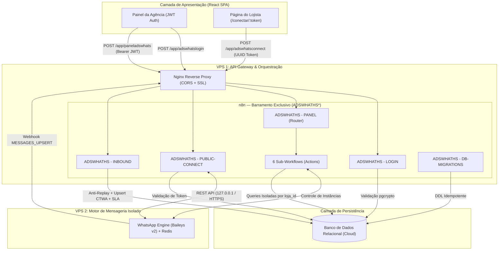

<div align="center">

# 🚀 AdsWhats Monitor

**Torre de Controle Operacional para Monitoramento de Tráfego WhatsApp, Atribuição de Anúncios Meta (CTWA) e Auditoria de SLA em Escala Multi-Loja.**

[](https://bun.sh/)
[](https://react.dev/)
[](https://www.typescriptlang.org/)
[](https://tailwindcss.com/)
[](https://n8n.io/)

</div>

---

## 📌 Visão Geral e Posicionamento

O **AdsWhats Monitor** foi projetado para **agências de tráfego pago e empresas gestoras** que operam múltiplos canais de WhatsApp comerciais para dezenas de lojas clientes. Ele resolve o ponto cego mais caro das operações de tráfego local: **saber exatamente qual anúncio gerou cada conversa e quanto tempo a equipe comercial da loja levou para responder o cliente.**

### ⚠️ O que o projeto É vs. O que NÃO É

| O que o AdsWhats Monitor **É** | O que o AdsWhats Monitor **NÃO É** |
| :--- | :--- |
| ✅ **Rastreador de Atribuição por Mensagem (Meta CTWA):** Identifica cliques em anúncios de Instagram/Facebook mesmo quando o contato já conversava com a loja anteriormente. | ❌ **Não é um CRM ou Kanban de Vendas:** Não possui funil de etapas, qualificação manual de leads ou agendamento de tarefas. |
| ✅ **Auditor de SLA de Primeiro Atendimento:** Mede ao segundo o tempo entre o `inbound` do cliente e o primeiro `outbound` da loja. | ❌ **Não é uma plataforma de atendimento humano (Omnichannel):** Os vendedores continuam atendendo no próprio aparelho ou WhatsApp Web da loja. |
| ✅ **Torre de Controle Multi-Loja:** Visão centralizada para operadores e Super Admins com isolamento rigoroso por `loja_id`. | ❌ **Não exige login técnico do lojista:** O dono da loja conecta o WhatsApp através de um link público tokenizado em 15 segundos. |

---

## 🌟 Funcionalidades de Destaque

### 1. 🎯 Atribuição de Anúncios no Nível da Mensagem (Meta CTWA)
Diferente de CRMs tradicionais que atribuem a origem apenas no cadastro inicial do lead, o AdsWhats Monitor inspeciona os metadados de cada evento recebido:
- Captura `ctwa_clid`, ID do anúncio (`ad_id`), título, tema, canal (`instagram` / `facebook`) e URL da mídia.
- Se um cliente orgânico antigo clicar em uma nova campanha patrocinada meses depois, a nova conversa é atribuída ao novo criativo sem perder o histórico anterior.
- Contabilização automática de **Total de Mensagens** e **Pessoas Únicas** por criativo.

### 2. ⏱️ Motor de Cálculo de SLA de Primeiro Atendimento
O cálculo de tempo de resposta acontece de forma determinística no recebimento dos eventos:
- Toda mensagem recebida do cliente (`direcao = 'inbound'`) abre uma janela de espera.
- Assim que a loja envia a primeira resposta (`direcao = 'outbound'`), o sistema vincula o `respondida_por_mensagem_id`, carimba o `respondida_em` e calcula o `tempo_resposta_segundos`.
- **Consolidação em 4 dimensões:** SLA médio global, por loja, por criativo de anúncio e por contato individual, com filtros temporais de **7, 15, 30 ou 90 dias**.

### 3. 🔗 Onboarding Zero-Fricção para Lojistas (`/conectar/:token`)
Lojistas não precisam de usuário, senha ou acesso ao painel da agência:
- Cada loja recebe um `connect_token` (UUID único).
- O operador compartilha o link público `https://app.seudominio.com/conectar/{connect_token}`.
- A página gerencia automaticamente o provisionamento da sessão, exibe o QR Code em tempo real (com *polling* inteligente a cada 4s e auto-recuperação em caso de falha) e traz instruções passo a passo para **Android** e **iOS**.

### 4. 💬 Auditoria de Conversas em Tempo Real
- Visualização completa do histórico de chat (`inbound` e `outbound`) por contato.
- Destaque visual imediato (badges de campanha) nas mensagens exatas que vieram de cliques em anúncios.
- Suporte a visualização de textos, áudios, imagens, vídeos, documentos e figurinhas.

---

## 🏗️ Arquitetura de Engenharia & Segurança

### 🔒 Regra de Ouro (Zero Direct-DB Access)
> **O Frontend (SPA) jamais se conecta diretamente ao banco de dados.**
> Nenhuma chave de banco ou credencial de infraestrutura é exposta no navegador. Toda comunicação passa exclusivamente por um **API Gateway de Webhooks no n8n**, protegido por um proxy reverso Nginx que bloqueia acesso à raiz (`404`) e expõe apenas as rotas de aplicação.



### Por que 2 VPS separadas na topologia de produção?
Conexões de WhatsApp baseadas em WebSockets e processamento de mídia possuem picos de memória e reconexões constantes. Isolar o motor de mensageria na **VPS 2** (com Redis dedicado de 256MB LRU e banco local para sessões) garante que o **API Gateway (n8n)** e o **Frontend** na **VPS 1** operem com latência mínima e 100% de estabilidade.

---

## 🔌 Barramento de API & Workflows (`ADSWHATHS*`)

Todos os workflows de backend são versionados em JSON dentro de [`agente/workflows/`](./agente/workflows) e sincronizados via código.

### Workflows Centrais (`core/` e `panel/`)
| Workflow | Endpoint / Gatilho | Responsabilidade |
| :--- | :--- | :--- |
| **`ADSWHATHS - LOGIN`** | `POST /app/adswhatslogin` | Autentica operadores via E-mail ou WhatsApp + Senha (`crypt`) e emite token JWT. |
| **`ADSWHATHS - PANEL`** | `POST /app/paneladswhats` | Valida o Bearer JWT e atua como *API Router*, delegando a execução para o sub-workflow da `action` solicitada. |
| **`ADSWHATHS - PUBLIC-CONNECT`** | `POST /app/adswhatsconnect` | Valida o `connect_token` público da loja e gerencia o ciclo de vida do QR Code (`STATUS`, `CONNECT`, `RESTART`). |
| **`ADSWHATHS - INBOUND`** | Webhook de Mensageria | Filtra duplicidades (Anti-Replay), extrai metadados de anúncios Meta CTWA, atualiza contadores de criativos e calcula o SLA de resposta. |
| **`ADSWHATHS - DB-MIGRATIONS`** | Execução Manual Segura | Sem webhook público. Aplica migrações SQL pendentes em ordem cronológica e registra na tabela `schema_migrations`. |

### Sub-Workflows de Ação (`panel/actions/`)
Acionados internamente pelo `ADSWHATHS - PANEL` através do payload `{ "action": "NOME-DA-ACAO", "payload": { ... } }`:
- `GET-LOJAS`: Lista todas as lojas com contadores agregados de contatos e mensagens.
- `SAVE-LOJA`: Cria ou atualiza lojas, metadados comerciais e provisiona credenciais de instância.
- `EVOLUTION-API`: Executa comandos administrativos na instância da loja (`STATUS`, `CONNECT`, `LOGOUT`, `RESTART`).
- `GET-CONTACTS`: Lista leads filtrados por `loja_id`, origem (`organico`, `instagram_ads`, `facebook_ads`) e busca textual.
- `GET-CHAT-MESSAGES`: Retorna o histórico paginado de mensagens de um contato específico com dados do anúncio vinculado.
- `GET-METRICS-SLA`: Calcula os indicadores de SLA médio, volume de mensagens de anúncios e ranking de criativos por período.

---

## 🗄️ Modelo de Dados e Migrations

O esquema relacional utiliza chaves primárias inteiras sequenciais (`SERIAL` / `BIGSERIAL`) para alta performance de indexação e junção, combinado com `UUID` exclusivamente para tokens públicos de conexão:

- **`usuarios`**: Operadores e Super Admins da agência gestora.
- **`lojas`**: Unidades monitoradas, contendo `connect_token` (UUID) e configurações de integração em `config_json` (JSONB).
- **`criativos`**: Catálogo automático de anúncios Meta capturados via tráfego (`ad_id`, `titulo`, `tema`, `canal`, `media_url`, contadores).
- **`pessoas`**: Contatos únicos por loja (`UNIQUE (loja_id, whatsapp)`), guardando a referência ao `ultimo_criativo_id`.
- **`mensagens`**: Histórico `1:N` com flags de anúncio (`is_ad`, `criativo_id`, `ctwa_clid`) e métricas de SLA (`tempo_resposta_segundos`, `respondida_em`).
- **`webhook_evolution_logs`**: Barreira de idempotência (*anti-replay*) baseada em `message_id` único para descartar *retries* de rede.

As migrações SQL ficam versionadas em [`agente/migrations/`](./agente/migrations).

---

## 📂 Estrutura do Repositório

```text
adswhats-monitor/
├── .github/workflows/
│   └── ci.yml                      # Pipeline CI/CD (Build + Deploy Rsync + Deploy Workflows n8n)
├── agente/
│   ├── migrations/                 # Migrações SQL numeradas (001 a 005)
│   └── workflows/                  # Workflows do n8n versionados como código (JSON)
│       ├── core/                   # Login, Inbound, Public-Connect e DB-Migrations
│       └── panel/                  # Router principal do painel e sub-workflows em actions/
├── docs/                           # Documentação arquitetural, ADRs, schema SQL e topologia
├── infra/
│   ├── vps-n8n/                    # Docker Compose, script IaC de provisionamento e configs Nginx (VPS 1)
│   └── vps-evolution/              # Docker Compose, Redis LRU, script IaC e configs Nginx (VPS 2)
├── scripts/
│   ├── deploy_workflows_via_api.js # Deploy inteligente com ordenação topológica de dependências
│   ├── pull_workflows_via_api.js   # Sincronização reversa (baixa workflows do n8n para o repo)
│   ├── git_push_automacao.sh       # Automação de branch, commit e abertura de PR
│   └── git_clean_workspace.sh      # Limpeza pós-merge
└── src/
    ├── components/                 # UI modular (MetricsSLASection, LojaModal, ChatModal, Navbar)
    ├── contexts/                   # AuthContext (Sessão JWT e proteção de rotas)
    ├── lib/                        # Cliente HTTP centralizado (api.ts)
    ├── pages/                      # Telas: Dashboard, Criativos, Lojas, Contatos, PublicConnect, Login
    └── types/                      # Contratos estritos em TypeScript
```

---

## ⚡ Guia de Execução Rápida (Desenvolvimento)

> [!IMPORTANT]
> Este projeto utiliza exclusivamente o **[Bun](https://bun.sh/)** como runtime e gerenciador de pacotes. Não utilize `npm` ou `yarn`.

### 1. Pré-requisitos
- [Bun](https://bun.sh/) `>= 1.1` instalado.
- Uma instância do gateway **n8n** configurada com os workflows da pasta `agente/workflows/`.

### 2. Configuração de Ambiente
Crie um arquivo `.env` na raiz do projeto seguindo o modelo abaixo:

```dotenv
# URL base do Gateway de Webhooks (n8n via Nginx)
VITE_API_URL="https://api.seudominio.com/app"
VITE_APP_VERSION="1.0.0"

# Credenciais para sincronização de Workflows via CLI (opcional para dev frontend)
N8N_HOST="api.seudominio.com"
N8N_API_KEY="sua_api_key_do_n8n_aqui"
```

### 3. Instalação e Inicialização
```bash
# Instalar dependências com lockfile determinístico
bun install

# Iniciar servidor de desenvolvimento (Vite + SWC)
bun run dev

# Compilar versão otimizada de produção (gera pasta dist/)
bun run build
```

---

## 🔄 Automação de Workflows (Workflow-as-Code)

O repositório conta com um motor próprio em [`scripts/deploy_workflows_via_api.js`](./scripts/deploy_workflows_via_api.js) que resolve os dois maiores problemas do n8n em equipe: **dependência entre sub-workflows** e **mapeamento dinâmico de credenciais entre ambientes (Staging/Produção)**.

1. **Ordenação Topológica:** O script analisa a árvore de nós `executeWorkflow` e garante que os sub-workflows (`actions/`) sejam criados/atualizados antes dos workflows pais, injetando automaticamente os novos IDs gerados pelo servidor.
2. **Vínculo Automático de Credenciais:** Mapeia as credenciais existentes no servidor de destino pelo nome/tipo e reconecta os nós automaticamente durante o deploy.

```bash
# Fazer deploy de TODOS os workflows respeitando a árvore de dependências
bun run scripts/deploy_workflows_via_api.js

# Fazer deploy de apenas UM workflow específico alterado
bun run scripts/deploy_workflows_via_api.js "agente/workflows/core/ADSWHATHS - PUBLIC-CONNECT.json"

# Baixar atualizações feitas visualmente no n8n de volta para o repositório Git
bun run scripts/pull_workflows_via_api.js
```

---

## 🌐 Provisionamento de Infraestrutura (IaC) e CI/CD

Toda a configuração de servidores está documentada e pronta para uso na pasta [`infra/`](./infra):

- **Provisionamento Automatizado de VPS:** Os scripts [`infra/vps-n8n/deploy.sh`](./infra/vps-n8n/deploy.sh) e [`infra/vps-evolution/deploy.sh`](./infra/vps-evolution/deploy.sh) configuram automaticamente Swap de 2GB, Docker, Nginx, VirtualHosts com políticas de CORS/WebSockets e certificados SSL Let's Encrypt via Certbot.
- **Continuous Deployment (GitHub Actions):** Ao realizar o merge na branch `main`, a pipeline [`.github/workflows/ci.yml`](./.github/workflows/ci.yml) compila o frontend com Bun, publica o bundle estático via `rsync/SSH` diretamente no servidor Nginx e atualiza todos os workflows no n8n de produção via API.

Para detalhes aprofundados sobre topologia de rede e tabelas do banco, consulte a documentação técnica na pasta [`docs/`](./docs/README.md).

---

## 📄 Licença

Consulte as diretrizes de uso e licenciamento diretamente com os mantenedores do repositório.
