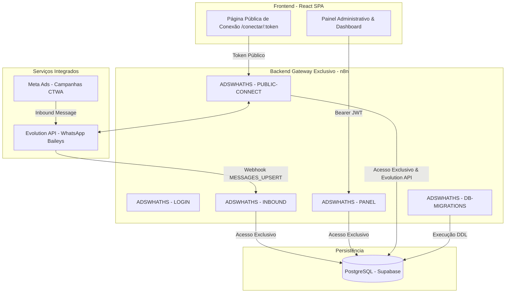

# 🚀 AdsWhats Monitor

> **Plataforma de Monitoramento de Tráfego WhatsApp, Atribuição de Anúncios Meta (CTWA) e Métricas de SLA.**

O **AdsWhats Monitor** é uma torre de controle operacional e analítica desenvolvida para agências e empresas gestoras monitorarem múltiplos canais de WhatsApp comerciais, atribuir mensagens a anúncios pagos da Meta e acompanhar o tempo de resposta (SLA) de atendimento de cada loja em tempo real.

---

### ⚠️ O que o AdsWhats Monitor É e o que NÃO É

- **O QUE É:** Um monitor técnico e analítico de conversas, anúncios patrocinados (Click to WhatsApp) e performance de atendimento de lojas.
- **O QUE NÃO É:** **Não é um CRM.** Não possui funil de vendas, etapas de pipeline nem status de cliente. O objetivo é visibilidade, auditoria de tráfego e qualidade do primeiro atendimento.

---

## 🌟 Principais Recursos

### 1. 🎯 Atribuição de Anúncios por Mensagem (Meta CTWA)
- A atribuição é realizada **a nível de mensagem**, e não apenas de lead.
- Identifica se um contato antigo clicou novamente em um anúncio recente.
- Captura de metadados completos da Meta: `ctwa_clid`, título do anúncio, tema e canal de veiculação.

### 2. 🎨 Painel de Criativos & Performance
- Mapeamento e agrupamento automático de criativos da Meta.
- Relatório de volume de mensagens geradas por criativo.
- Visão clara de quais campanhas e anúncios estão gerando maior tração nas lojas.

### 3. ⏱️ Métricas de SLA de Primeiro Atendimento
- Cálculo preciso do tempo decorrido entre a mensagem recebida (`inbound`) e a primeira resposta enviada (`outbound`).
- Indicadores de SLA médio calculados por:
  - Loja
  - Criativo de anúncio
  - Contato
  - Período selecionado (7, 15, 30 ou 90 dias)

### 4. 🔗 Link de Conexão Pública para Lojistas (`/conectar/:token`)
- Cada loja possui um link seguro e exclusivo (`/conectar/{connect_token}`).
- Permite que o lojista escaneie o QR Code diretamente do seu celular comercial.
- Sem necessidade de login no painel administrativo e sem expor chaves ou instâncias internas.
- Atualização e polling em tempo real com transição automática para o estado conectado.

### 5. 💬 Histórico de Chat & Auditoria
- Visualização de conversas trocadas em tempo real.
- Selo de identificação visual nas mensagens originadas por cliques em anúncios.
- Exibição de texto, áudio, imagens e mídias recebidas.

### 6. 🏪 Gestão Multiloja com Isolamento Estrito
- Projetado para uso por Super Admins e operadores de agência gestora.
- Filtros globais por loja em todas as telas (Dashboard, Contatos, Criativos, Lojas).
- Isolamento por `loja_id` em todas as consultas e persistências.

---

## 🏗️ Arquitetura de Engenharia

O projeto adota uma arquitetura desacoplada e estritamente segura:



### 🔒 Regra de Ouro da Arquitetura
> **O Frontend e o ambiente local NÃO possuem acesso direto ao banco de dados PostgreSQL no Supabase.**
> O **n8n** é o gateway exclusivo e centralizador de todas as consultas, gravações, regras de negócio e integrações externas. Nenhuma credencial de banco é exposta ao cliente.

---

## 🛠️ Stack Tecnológica

| Camada | Tecnologia |
| :--- | :--- |
| **Runtime** | [Bun](https://bun.sh/) (exclusivo para scripts e execução local) |
| **Frontend** | React 19, TypeScript, Vite, Tailwind CSS |
| **Componentes & UI** | Lucide React, Sonner (Toasts), Tailwind Merge |
| **Backend / Gateway** | [n8n](https://n8n.io/) (Workflows com prefixo `ADSWHATHS*`) |
| **Banco de Dados** | PostgreSQL (Supabase) com versionamento via migrações SQL |
| **WhatsApp Gateway** | [Evolution API v2](https://evolution-api.com/) (WhatsApp Baileys) |

---

## 📂 Estrutura do Repositório

```bash
adswhats-monitor/
├── .github/workflows/          # Pipelines de CI/CD (GitHub Actions)
├── agente/
│   ├── migrations/             # Migrações SQL versionadas (001 a 005)
│   └── workflows/              # Workflows JSON do n8n versionados
│       ├── core/               # Workflows centrais (Inbound, Connect, Migrations, Login)
│       └── panel/              # Barramento do painel e sub-workflows de ação
├── docs/                       # Especificações arquiteturais e modelo de dados
├── scripts/
│   ├── deploy_workflows_via_api.js # Script de deploy de workflows no n8n via API
│   └── pull_workflows_via_api.js   # Script de download/sincronização do n8n localmente
├── src/
│   ├── components/             # Componentes modulares (ChatModal, LojaModal, MetricsSLA, Navbar)
│   ├── contexts/               # Contexto global de autenticação (AuthContext)
│   ├── pages/                  # Telas (Dashboard, Contatos, Criativos, Lojas, PublicConnect, Login)
│   ├── types/                  # Definições de tipos TypeScript (Loja, Contato, Auth)
│   └── lib/                    # Cliente HTTP para barramento n8n (api.ts)
├── package.json
└── vite.config.ts
```

---

## ⚙️ Guia de Desenvolvimento & Operação

### 1. Pré-requisitos
- [Bun](https://bun.sh/) instalado no ambiente.

### 2. Instalação e Execução Local
```bash
# Instalar dependências
bun install

# Iniciar servidor de desenvolvimento
bun run dev

# Gerar build de produção otimizado
bun run build
```

### 3. Gerenciamento de Workflows no n8n

```bash
# Baixar workflows da instância n8n para o repositório local
bun run scripts/pull_workflows_via_api.js "PUBLIC-CONNECT"

# Fazer deploy de um workflow alterado para a instância n8n
bun run scripts/deploy_workflows_via_api.js "agente/workflows/core/ADSWHATHS - PUBLIC-CONNECT.json"
```

---

## 📄 Licença & Propriedade

Desenvolvido exclusivamente para o ecossistema **AdsWhats Monitor**. Todos os direitos reservados.
