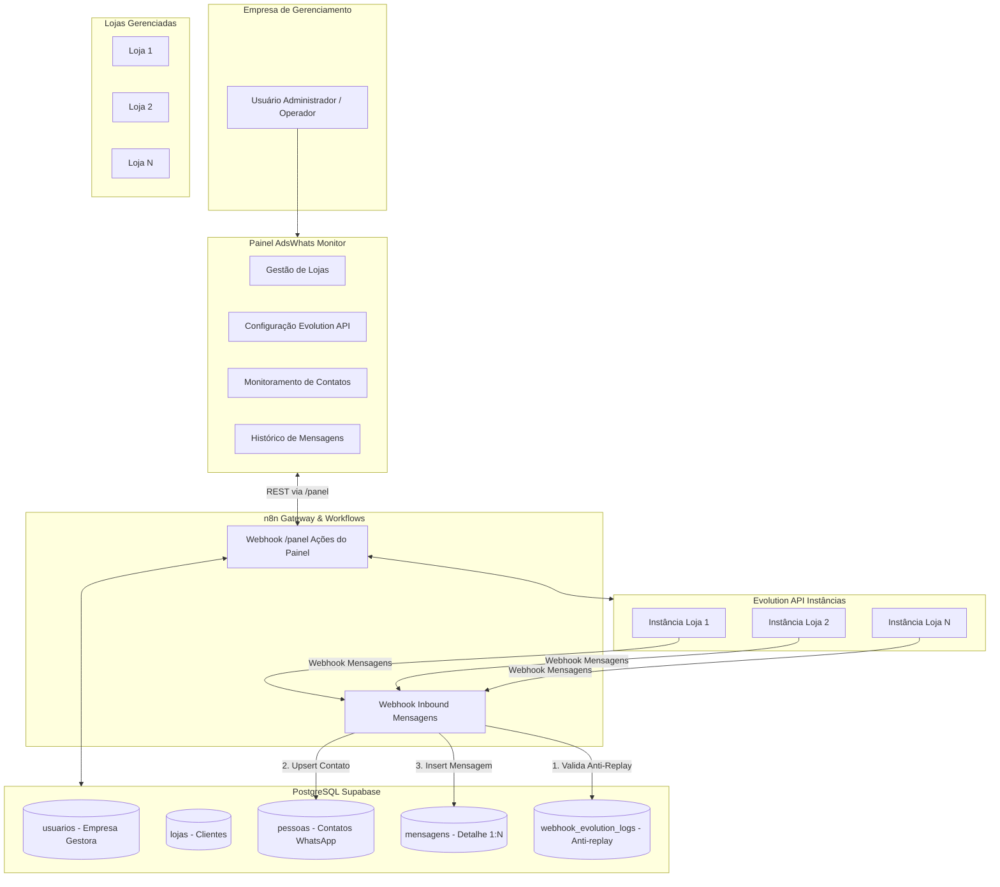

# AdsWhats Monitor — Arquitetura de Gestão e Modelo de Dados

## 1. Visão Geral da Arquitetura Multi-Loja

O **AdsWhats Monitor** opera como uma torre de controle central para a **empresa de gerenciamento**.

---

## 2. Especificação do Modelo de Tabelas (PostgreSQL)

> [!NOTE]
> Todos os identificadores utilizam inteiros sequenciais padrão (`SERIAL` / `BIGSERIAL`), sem uso de UUIDs.

### A. Tabela `usuarios` (Operadores da Empresa Gestora)
Usuários do sistema não pertencem a uma loja específica. São os operadores e administradores da plataforma.
* `id` (SERIAL, PK)
* `nome` (VARCHAR)
* `email` (VARCHAR, UNIQUE)
* `whatsapp` (VARCHAR, UNIQUE - usado para login com telefone)
* `password_hash` (TEXT)
* `role` (VARCHAR: `admin`, `operador`)
* `avatar_url` (TEXT)
* `ativo` (BOOLEAN, default true)
* `created_at` (TIMESTAMPTZ)
* `ultimo_login` (TIMESTAMPTZ)

### B. Tabela `lojas` (Lojas Clientes Gerenciadas)
Representa as lojas monitoradas pela plataforma.
* `id` (SERIAL, PK)
* `nome` (VARCHAR)
* `whatsapp_loja` (VARCHAR - número principal/instância)
* `ativo` (BOOLEAN, default true)
* `config_json` (JSONB)
  - `evolutionapi`:
    - `instanceName`: Nome da instância na Evolution API
    - `apikey`: API Key da Evolution API
    - `apiUrl`: URL base da Evolution API
    - `webhookUrl`: URL do webhook do n8n configurado
  - `notificacoes`: Alertas de desconexão ou volume
* `created_at` (TIMESTAMPTZ)
* `updated_at` (TIMESTAMPTZ)

### C. Tabela `pessoas` (Mestre de Contatos / Leads)
Centraliza cada pessoa que entrou em contato no WhatsApp de uma loja.
* `id` (BIGSERIAL, PK)
* `loja_id` (INT, FK -> lojas.id)
* `nome` (VARCHAR)
* `whatsapp` (VARCHAR) — número do cliente
* `picture_url` (TEXT) — foto do perfil WhatsApp
* `status` (VARCHAR: `novo`, `em_atendimento`, `finalizado`, etc.)
* `total_mensagens` (INT, default 0)
* `last_message_at` (TIMESTAMPTZ) — momento da última mensagem (para ordenação rápida)
* `created_at` (TIMESTAMPTZ)
* **Índices:** `UNIQUE (loja_id, whatsapp)`, `INDEX (loja_id, last_message_at DESC)`

### D. Tabela `mensagens` (Detalhe 1:N com Pessoas)
Guarda o histórico individualizado de cada mensagem trocada.
* `id` (BIGSERIAL, PK)
* `loja_id` (INT, FK -> lojas.id)
* `pessoa_id` (BIGINT, FK -> pessoas.id)
* `message_id` (VARCHAR) — ID original da mensagem vindo da Evolution API
* `direcao` (VARCHAR: `inbound` [cliente enviou] | `outbound` [loja/bot enviou])
* `tipo` (VARCHAR: `texto`, `audio`, `imagem`, `video`, `documento`, `sticker`)
* `conteudo` (TEXT) — texto da mensagem ou descrição/caption
* `midia_url` (TEXT, opcional) — URL ou caminho da mídia/áudio
* `status_entrega` (VARCHAR: `sent`, `delivered`, `read`)
* `timestamp_mensagem` (TIMESTAMPTZ) — data/hora registrada no WhatsApp
* `created_at` (TIMESTAMPTZ, default now())
* **Índices:** `INDEX (pessoa_id, created_at ASC)`, `UNIQUE (loja_id, message_id)`

### E. Tabela `webhook_evolution_logs` (Barreira Anti-Replay)
Evita processamento de mensagens duplicadas disparadas por retry de webhook.
* `id` (BIGSERIAL, PK)
* `message_id` (VARCHAR, UNIQUE)
* `payload` (JSONB)
* `created_at` (TIMESTAMPTZ)

### F. Tabela `criativos` (Agrupamento e Métricas de Anúncios)
Consolida métricas e agrupadores de campanhas Meta Ads (Instagram/Facebook) e Google Ads.
* `id` (SERIAL, PK)
* `loja_id` (INT, FK -> lojas.id)
* `ad_id` (VARCHAR) — ID do anúncio Meta ou código `google_[termo]`
* `titulo` (VARCHAR) — Título do criativo ou termo da palavra-chave/cupom
* `tema` (TEXT) — Descrição/legenda do criativo ou detalhe da conversão
* `canal` (VARCHAR: `instagram`, `facebook`, `google`)
* `media_url` (TEXT) — URL da imagem/thumbnail do criativo
* `source_url` (TEXT) — Link original do anúncio / URL de destino
* `total_mensagens` (INT, default 0)
* `total_pessoas_unicas` (INT, default 0)
* `primeira_mensagem_at` (TIMESTAMPTZ)
* `ultima_mensagem_at` (TIMESTAMPTZ)
* `created_at` (TIMESTAMPTZ)
* `updated_at` (TIMESTAMPTZ)
* **Índices:** `UNIQUE (loja_id, ad_id)`, `INDEX (loja_id)`, `INDEX (canal)`

