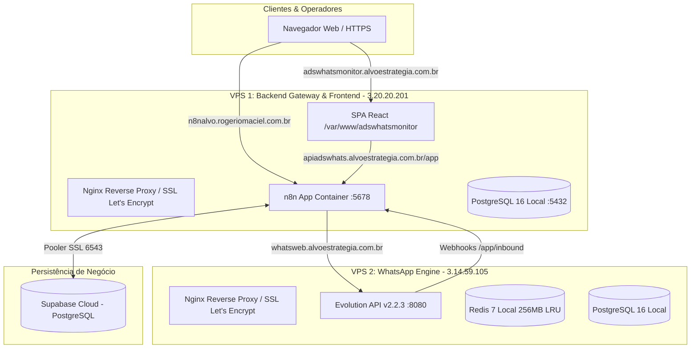

# 🌐 Infraestrutura de Produção e CI/CD — AdsWhats Monitor

Este documento detalha a topologia de servidores em produção, subdomínios, configurações de Nginx, SSL e o fluxo automatizado de integração e entrega contínua (CI/CD).

---

## 🏗️ 1. Topologia de Servidores & Domínios

A infraestrutura foi desenhada para isolar a instabilidade natural de conexões do WhatsApp da torre de controle central (n8n) e da interface de usuário.



---

## 📌 2. Mapeamento de Domínios e Serviços

| Domínio | Host IP | Serviço | Segurança / Regras |
| :--- | :--- | :--- | :--- |
| **`adswhatsmonitor.alvoestrategia.com.br`** | `3.20.20.201` | Frontend SPA (React + Vite) | Gzip ativo, cache longo de assets (`/assets/`), fallback para `index.html`. |
| **`apiadswhats.alvoestrategia.com.br`** | `3.20.20.201` | Gateway Público de API / Webhooks | Raiz `/` bloqueada com **404**. Rotas `/app` e `/api` liberadas com **CORS completo**. |
| **`n8nalvo.rogeriomaciel.com.br`** | `3.20.20.201` | Painel Administrativo do n8n | Acesso restrito ao editor e workflows do n8n com WebSockets. |
| **`whatsweb.alvoestrategia.com.br`** | `3.14.59.105` | Evolution API (v2.2.3) | Timeouts de 86400s para SSE/WebSockets, upload até 100MB, Redis com limite de 256MB. |

---

## 🚀 3. Pipeline de CI/CD (GitHub Actions)

A esteira de integração e entrega contínua está definida em [`.github/workflows/ci.yml`](file:///.github/workflows/ci.yml) e é disparada **exclusivamente após a aprovação e merge de Pull Requests na branch `main`**.

### 🔒 Segredos Utilizados (GitHub Actions Secrets):
- `VITE_API_URL`: `https://apiadswhats.alvoestrategia.com.br/app`
- `PROD_N8N_HOST`: `apiadswhats.alvoestrategia.com.br`
- `PROD_N8N_API_KEY`: API Key oficial do n8n
- `SSH_HOST`: `3.20.20.201`
- `SSH_USER`: `ubuntu`
- `SSH_PORT`: `22`
- `SSH_PRIVATE_KEY`: Chave RSA autorizada na VPS
- `DEPLOY_TARGET`: `/var/www/adswhatsmonitor`

---

## 🛠️ 4. Fluxo Git Flow para o Agente e Desenvolvedores

Conforme detalhado no skill [`.agent/skills/git-agent-workflow.md`](file:///.agent/skills/git-agent-workflow.md):

1. **Abrir Branch e PR via Script:**
   ```bash
   bash scripts/git_push_automacao.sh feature/nova-melhoria "feat: adiciona nova funcionalidade"
   ```
2. **Validar CI no GitHub:**
   O GitHub Actions executará os testes e compilação do TypeScript.
3. **Merge na `main`:**
   Ao mesclar o Pull Request, o GitHub Actions realiza o build de produção, publica os arquivos estáticos na VPS via SSH/Rsync e executa o deploy automático de todos os workflows no n8n.
4. **Sincronizar e Limpar:**
   ```bash
   bash scripts/git_clean_workspace.sh
   ```
