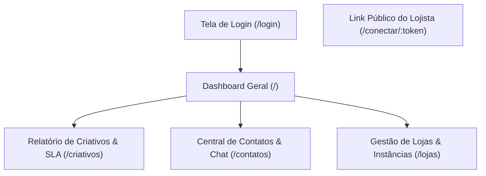

# AdsWhats Monitor — Escopo & Diferenciais do Produto

Este documento define o escopo exato e os limites funcionais do **AdsWhats Monitor**.

---

## 1. Missão Única do AdsWhats Monitor

> **Objetivo Exclusivo:** Monitorar contatos e leads que chegam via WhatsApp no número/instância da loja, atribuir conversas a criativos de anúncios pagos (Meta CTWA) e auditar o SLA de primeiro atendimento.

O **AdsWhats Monitor** foca **100% em visibilidade de tráfego, auditoria de atendimento e inteligência de atribuição multi-loja**, sem carregar a complexidade de sistemas de ERP ou CRMs tradicionais de vendas.

---

## 2. Pilares Técnicos da Plataforma

### A. Autenticação e Controle de Acesso (Empresa Gestora)
* **Login Flexível:** Autenticação via E-mail ou WhatsApp + Senha.
* **Endpoint no Gateway:** Webhook dedicado (`/app/adswhatslogin`).
* **Sessão:** JWT/Bearer Token armazenado no cliente e validado no barramento central com segredo gerenciado exclusivamente no banco (`configs.jwtkey`).

### B. Integração de Mensageria & Atribuição CTWA
* **Recepção de Webhook:** Entrada de eventos em tempo real (`MESSAGES_UPSERT`, `CONNECTION_UPDATE`).
* **Proteção Anti-Replay:** Tabela de logs (`webhook_evolution_logs`) para evitar processamento duplicado de mensagens (`message_id UNIQUE`).
* **Atribuição por Mensagem:** Extração de metadados de campanhas Click-to-WhatsApp (`adId`, `ctwaClid`, título, tema e canal) diretamente em cada mensagem recebida.
* **Cálculo Determinístico de SLA:** Medição em segundos entre a mensagem `inbound` do cliente e a primeira resposta `outbound` da loja.
* **Onboarding Público (`/conectar/:token`):** Página externa segura e sem senha para o lojista parear o WhatsApp da loja via QR Code.

### C. Barramento de Ações do Painel (n8n Actions)
* Frontend chama `POST /app/paneladswhats` com `{ action: "ACTION_NAME", payload: { ... } }`.
* O gateway possui sub-workflows dedicados por ação (`ADSWHATHS-PANEL-ACTION-...`), mantendo desacoplamento total.

---

## 3. O que NÃO Faz Parte do Escopo (Limites Claros)

| Fora do Escopo | Motivo |
| :--- | :--- |
| **Funil Kanban / Pipeline de Vendas** | O foco é auditoria de tráfego e tempo de resposta, não gestão de etapas comerciais. |
| **Atendimento Humano Multi-Agente (Chat Ao Vivo)** | Os vendedores atendem diretamente no aparelho ou WhatsApp Web da própria loja. |
| **Disparo em Massa / Automação de Marketing** | O sistema atua de forma passiva e analítica para proteger a reputação dos números conectados. |

---

## 4. Mapa de Telas do Frontend

1. **Dashboard Geral (`/`):**
   - KPIs globais de lojas, contatos e mensagens.
   - Resumo de SLA médio, mediano, taxa de resposta e ranking de criativos.
2. **Relatório de Criativos & SLA (`/criativos`):**
   - Análise aprofundada por anúncio Meta Ads, performance por loja, evolução diária e SLA por contato.
3. **Central de Contatos & Auditoria de Chat (`/contatos`):**
   - Lista de contatos isolada por `loja_id`, filtro por canal de origem e modal de histórico de conversa com selos de anúncio e transcrição de áudio.
4. **Gestão de Lojas & Instâncias (`/lojas`):**
   - Cadastro multi-loja, gerenciamento de conexão WhatsApp e compartilhamento do link público do lojista.
