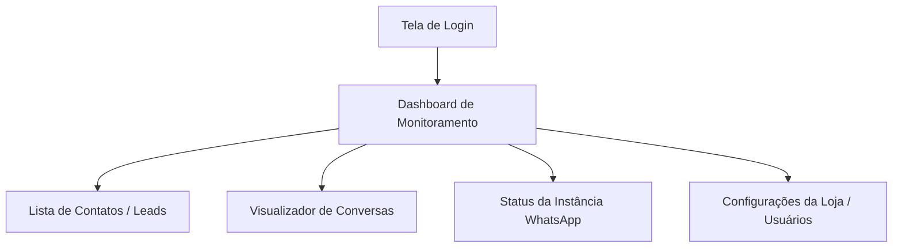

# AdsWhats Monitor — Escopo Simplificado & Mapeamento de Referência

Baseado na arquitetura do projeto de referência (`../coreauto-insight`), este documento define o escopo exato do **AdsWhats Monitor**.

---

## 1. Missão Única do AdsWhats Monitor

> **Objetivo Exclusivo:** Monitorar contatos e leads que chegam via WhatsApp no número/instância da loja.

Diferente do `coreauto-insight` (que é um ERP automotivo completo com OS, mecânicos, orçamentos e painéis para Smart TV), o **AdsWhats Monitor** remove toda a complexidade de oficina mecânica e foca **100% no funil de atendimento e monitoramento de contatos do WhatsApp**.

---

## 2. O que APROVEITAMOS (Quase 1:1) do `coreauto-insight`

### A. Autenticação e Usuários
* **Mesmo modelo:** Login via WhatsApp + Senha (e/ou Google Identity).
* **Endpoints no n8n:** Webhook de autenticação (`/coreautologin` ou equivalente `adswhatslogin`).
* **Sessão:** JWT/Bearer Token armazenado no `localStorage`, repassado nos headers das requisições.
* **Telas:** Tela de Login e Gestão de Usuários/Equipe simples.

### B. Integração com Evolution API
* **Recepção de Webhook:** Entrada de eventos de mensagens (`messages.upsert`, `connection.update`, etc.).
* **Proteção Anti-Replay:** Tabela de logs para evitar processamento duplicado de mensagens (`message_id UNIQUE`).
* **Conexão de Instância:** Leitura de status da instância (Conectado / Desconectado / QR Code) via actions do n8n.
* **Envio/Interação:** Capacidade de visualizar histórico do chat e enviar mensagens caso necessário.

### C. Barramento de Ações do Painel (n8n Actions)
* Frontend chama `POST /panel` com `{ action: "ACTION_NAME", payload: { ... } }`.
* n8n possui workflows dedicados por ação (`ADSWATHS-PANEL-ACTION-...`), mantendo desacoplamento total.

---

## 3. O que DESCARTAMOS do `coreauto-insight` (Sem ruído de ERP)

| Descartado (Não entra no AdsWhats) | Motivo |
| :--- | :--- |
| **Ordens de Serviço (OS) & Orçamentos** | Foco é apenas contato/conversa, não reparos ou peças. |
| **Mecânicos, Consultores de Pátio e Comissões** | Mão de obra e cargos de oficina são irrelevantes aqui. |
| **Painel de Smart TV & Heatmap 3D** | Modo TV de pátio não se aplica. |
| **Check-in Express & Leitura de Placas** | Não há veículos físicos envolvidos. |
| **Sprints de Oficina e Diários de Bordo** | Gestão ágil de oficina mecânica removida. |

---

## 4. O que FICA no Frontend (Interface Enxuta)

1. **Dashboard / Indicadores:**
   - Volume de novos contatos recebidos (dia/semana/mês).
   - Horários de pico de contato.
   - Status da conexão do WhatsApp (Evolution API).
2. **Central de Contatos / Chat:**
   - Lista de pessoas que chamaram no WhatsApp.
   - Histórico detalhado de mensagens recebidas e enviadas.
3. **Instância / Conexão:**
   - Status de conexão da Evolution API e QR Code de pareamento.
4. **Configurações / Usuários:**
   - Dados da loja e controle de acesso de usuários.
